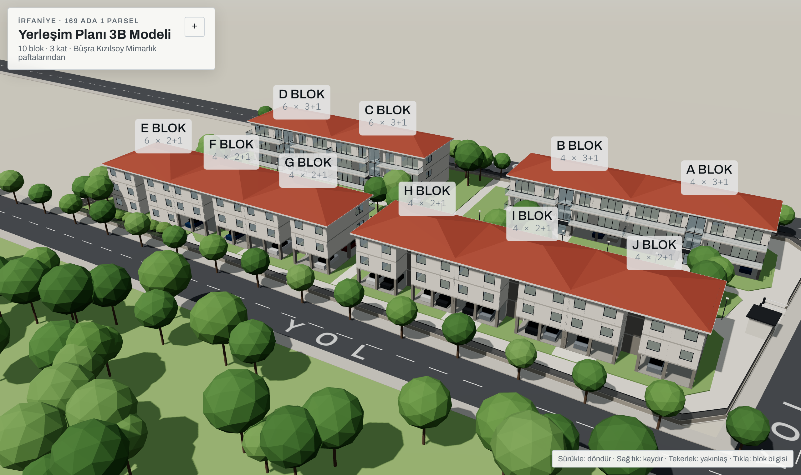
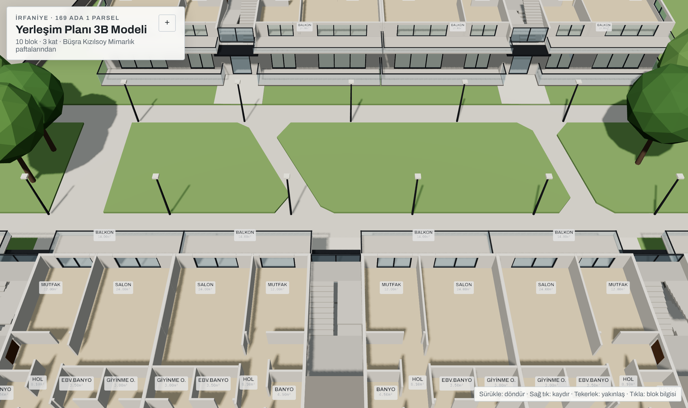
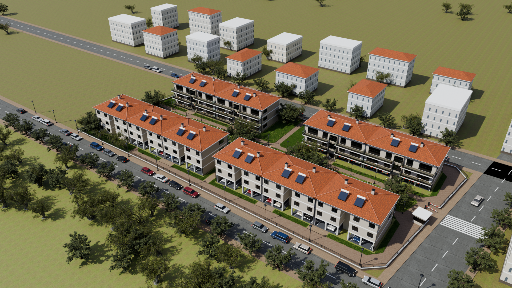

# İrfaniye 169 Ada 1 Parsel: 3B Yerleşim Modeli

Büşra Kızılsoy Mimarlık Ofisi paftalarından (Yerleşim Planı, 110 m² ve 87,50 m² emsal daire planları, Yerleşim Kesiti) üretilmiş 3B site modeli.



## Modelde neler var

| | |
|---|---|
| Bloklar | 10 blok (A–J), her blok 3 katlı, katta 2 daire, ortada merdiven + asansör çekirdeği |
| Kuzey sıra | D, C: 6'şar adet 3+1 · B, A: zemin otopark + 4'er adet 3+1 |
| Güney sıra | E: 6 adet 2+1 · F, G, H, I, J: zemin otopark + 4'er adet 2+1 |
| Toplam | 46 daire (20 × 3+1, 26 × 2+1) |
| 3+1 | Emsal 110,00 m², brüt 119,00 m², taban ≈ 9,39 × 11,53 m, balkon 2,0 m |
| 2+1 | Emsal 87,50 m², brüt 101,50 m², taban ≈ 7,09 × 12,39 m, balkon 2,0 m |
| Parsel | Çizimden ölçülen alan ≈ 6.400 m² |

Her dairenin iç bölme duvarları, pencere ve balkon kapısı boşlukları, daire giriş kapıları, merdiven kolları (10'ar basamak), sahanlıklar ve asansör kuyusu modellendi. Peyzajda yeşil alanlar, avlu adacıkları ve yürüyüş yolları, ağaçlar, otopark girişleri, çevre duvarı, site girişindeki güvenlik kulübesi ve bariyerler, çevredeki yollar ve park yer alıyor.



## Ölçüler nasıl alındı

Paftalar vektör PDF olduğu için ölçüler görüntüden tahmin edilmedi, doğrudan çizim verisinden okundu:

- Daire planlarındaki duvar poligonları (her dairede 29–30 parça) birebir 3B'ye ekstrüde edildi. Dış duvar 15 cm, iç duvar 10 cm çıkıyor.
- Ölçek merdiven basamaklarından doğrulandı: basamak aralığı 30 cm'ye denk geliyor. Bu ölçekle daire tabanları emsal alanlarıyla ve balkonlar (19 m², 14 m²) çizimdeki değerlerle tutarlı.
- Dış duvarlardaki boşluklar pencere, balkon kapısı veya daire girişi olarak sınıflandırıldı. Bitişik bloklarda birbirine bakan yan pencereler kapatıldı.
- Blok yerleri, parsel sınırı, yeşil alanlar, yollar ve ağaçlar yerleşim planından alındı.

## Varsayımlar (çizimlerde yok)

- Kat yüksekliği 3,00 m (döşeme 18 cm), zemin kotu +0,30 m
- Çatı: %33 eğimli kırma çatı, 60 cm saçak
- Kuzey paftanın üst kenarı kabul edildi (güneş yönü buna göre)
- Pencere denizlikleri 90 cm, küçük pencerelerde 150 cm. Pencere üst kotu 230 cm
- Otopark katları açık (kolonlu), araçlar temsilî

## Dosyalar

| Dosya | Ne işe yarar |
|---|---|
| `model.html` | Tarayıcıda açılan etkileşimli model. Çift tıklayıp açın (three.js CDN'den yüklendiği için internet gerekir) |
| `index.html` | Aynı model, Claude Artifact sürümü |
| `cikti/irfaniye_169_1.glb` | Tüm model, glTF 2.0. Blender, Windows 3B Görüntüleyici ve web görüntüleyicilerde açılır |
| `cikti/irfaniye_169_1_obj.zip` | OBJ + MTL (malzeme renkleriyle). Rhino, 3ds Max, Blender ve OBJ içe aktarabilen diğer yazılımlar için |
| `kaynak/` | Modeli yeniden üreten betikler |

Dışa aktarılan dosyalarda birim metredir, Y ekseni yukarıdır. Katmanlar: `Zemin_Kat`, `1_Kat`, `2_Kat`, `Cati`, `Peyzaj`, `Agaclar`, `Araclar`.

## Etkileşimli modelde

- **Kamera:** Perspektif, Kuş bakışı ve Avlu (yaya gözü)
- **Kat kesiti:** Zemin, 1. veya 2. kat seçilince üstteki katlar kaldırılır, duvarlar kesilir ve oda adları ile alanları görünür
- **Bloğa tıklama:** kat dağılımı, daire ve blok emsal/brüt toplamları
- **Katmanlar:** çatılar, ağaçlar, blok adları, araçlar · güneş konumu

## Gerçekçi render (Blender + Cycles)

`render/` klasöründeki betik, aynı plan verisinden açık kaynak **Blender 5.3** (Cycles yol izleme motoru) ile ayrıntılı bir sahne kurar ve fotogerçekçi görseller üretir.



| Görsel | |
|---|---|
| `gorseller/render/kus_bakisi.png` | Güneydoğudan kuş bakışı |
| `gorseller/render/kus_bakisi_alcak.png` | Alçak açı kuş bakışı, ufuk çizgisiyle |
| `gorseller/render/kus_bakisi_kuzeybati.png` | Kuzeybatıdan kuş bakışı |
| `gorseller/render/avlu.png` | İç avlu, yaya gözü |
| `gorseller/render/cephe.png` | B Blok giriş cephesi |
| `gorseller/render/giris.png` | Doğu yolundan site girişi |
| `gorseller/render/sokak.png` | Güney yolundan F–J blokları ve otopark girişleri |

**Cephe ayrıntıları:** antrasit alüminyum doğramalar (kasa, kayıt, orta dikme), mermer denizlikler, sürme balkon kapıları, iç tarafta tül ve fon perdeler, kat silmeleri, taş kaplı subasman, açık renkli kompozit kaplamalı merdiven kuleleri ve blok uç cepheleri, giriş saçağı ve blok tabelası, cam korkuluklu balkonlar (paslanmaz dikme ve küpeşte), balkonlarda klima dış üniteleri, saksılar, masa-sandalye; kil kiremitli kırma çatı, mahya ve kırma mahyaları, oluklar ve iniş boruları, bacalar, güneş enerjili su ısıtıcıları.

**Çevre:** gerçek ağaç ve çalı modelleri, tek tek çim sapları (yaklaşık 200 bin tutam), çit önü ve teras önü çalı sıraları, aydınlatma direkleri, bolarlar, banklar, taş kaplı çevre duvarı ve demir korkuluk, güvenlik kulübesi ve bariyerler, yaya geçidi, park etmiş ve seyir hâlindeki araçlar (sedan, hatchback ve SUV, 7 renk), otoparkta çizgiler ve LED armatürler, komşu binalar ve park.

> Cephe malzemeleri ve renkleri, araç ve peyzaj donatıları paftalarda yer almıyor. Bunlar görselleştirme için benim seçtiğim örnek bir malzeme kurgusu. Bina ölçüleri, pencere yerleri, balkonlar, merdivenler ve yerleşim paftalardan alınmıştır.

### Render'ı yeniden üretme

```bash
cd render
pip install bpy                 # Blender 5.x Python modülü
python indir.py assets          # Poly Haven'dan CC0 doku, model ve HDRI (~450 MB)
python sahne.py --kaydet sahne.blend \
    --render kus_bakisi,avlu,cephe,giris,sokak --cozunurluk 1920x1080 --ornek 128 --cikti ../gorseller/render
```

`sahne.blend` dosyası Blender'da açılıp düzenlenebilir (yaklaşık 280 MB olduğu için depoya eklenmedi). Güneş açısı `--gunes` (derece, azimut) ile değiştirilebilir.

Kullanılan Poly Haven varlıkları (CC0): `kloofendal_48d_partly_cloudy_puresky` HDRI; `plastered_wall_02`, `exterior_wall_cladding_03`, `granite_tile_04`, `clay_roof_tiles_02`, `concrete_pavers_02`, `rectangular_paving`, `asphalt_02`, `leafy_grass`, `concrete_tile_facade` dokuları; `jacaranda_tree`, `island_tree_01`, `island_tree_02`, `shrub_02`, `shrub_03`, `searsia_lucida` modelleri.

## Yeniden üretme (etkileşimli model)

```bash
cd kaynak
pip install pymupdf
python extract.py <Irfaniye_169-1.pdf> plan.json   # vektör verisini çıkarır
python process.py plan.json geo.json                 # metreye çevirir, boşlukları bulur
# geo.json'dan units.json: her tip için L, R ve labels alanları
python build.py                                      # index.html ve model.html
# GLB/OBJ: model.html'i three.js yerelden sunulacak şekilde açıp
node disa_aktar.js <url> ../cikti
```
